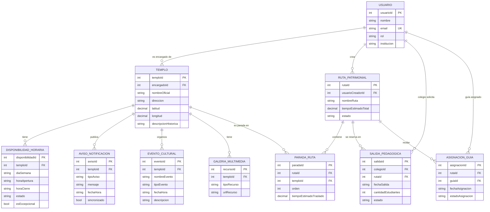

# Modelo Entidad-Relación — Patrimonio Arquidiócesis

_Fuente: `MoldeoBD.png`. Este es el modelo de la base de datos (la "verdad" de los datos). El mockup solo aporta el estilo visual._

## Diagrama ER

## Relaciones (en palabras)
- Un **usuario** con rol ENCARGADO administra varios **templos** (`templo.encargadoId`).
- Un **templo** tiene muchos **horarios**, **avisos**, **eventos** y **recursos de galería**.
- Un **usuario** crea varias **rutas**; una **ruta** tiene varias **paradas**, y cada parada apunta a un **templo** (PARADA_RUTA es la tabla puente ruta↔templo, con `orden`).
- Una **ruta** puede reservarse en **salidas pedagógicas** (las pide un usuario rol COLEGIO) y recibir **asignaciones de guía** (un usuario rol GUÍA).

## Pantalla → tablas que usa
| # | Pantalla | Tablas |
|---|---|---|
| 1 | Login | usuario |
| 2 | Registro | usuario |
| 3 | Inicio / Mapa | templo, disponibilidadHoraria |
| 4 | Ficha de templo | templo, disponibilidadHoraria, eventoCultural, galeriaMultimedia |
| 5 | Horarios del templo | disponibilidadHoraria |
| 6 | Agenda cultural | eventoCultural (+ templo) |
| 7 | Notificaciones | avisoNotificacion, eventoCultural, asignacionGuia ⚠️ |
| 8 | Perfil | usuario, rutaPatrimonial, asignacionGuia |
| 9 | Armar ruta | rutaPatrimonial, paradaRuta, templo |
| 10 | Detalle de ruta | rutaPatrimonial, paradaRuta, templo, asignacionGuia |
| 11 | Planificar salida pedagógica | salidaPedagogica, rutaPatrimonial, usuario(colegio) |
| 12 | Mis asignaciones | asignacionGuia, rutaPatrimonial, salidaPedagogica |
| 13 | Panel del encargado | templo, disponibilidadHoraria, avisoNotificacion, eventoCultural |
| 14 | Nuevo evento | eventoCultural (+ templo) |

## ⚠️ Huecos: dónde el mockup NO calza con la BD
| Hueco | Detalle | Qué hacemos |
|---|---|---|
| **Contraseña** | `usuario` no tiene columna de contraseña, pero Login/Registro la piden | Agregar `password` a `usuario` **en etapa 3** (backend). Por ahora vive en los datos de ejemplo. |
| **Notificaciones (#7)** | La pantalla muestra un feed por usuario (aviso de templo + evento nuevo + guía asignado), pero `avisoNotificacion` es **por templo** | **Derivar** el feed juntando avisos + eventos + asignaciones del usuario. No hay tabla propia; se arma en el repositorio. |
| **Institución (#2)** | El registro de un COLEGIO necesita institución | `usuario.institucion` ya existe; solo se muestra el campo cuando el rol es COLEGIO. |
| **Galería (#4)** | El mockup muestra 1 imagen (hero) | `galeriaMultimedia` permite varias; se puede mostrar 1 ahora y ampliar después. |

> Todo lo que el mockup tiene y la BD **no** respalda, no se inventa: se agrega como hueco aquí y se resuelve en etapa 3.

## 🗄️ Tabla local (SQLite, fuera del ER original)

Para la **persistencia local** (Prueba 2) se agrega una tabla **`configuracion`** → entidad `ConfiguracionApp` de **una sola fila** (`id = 1`): `sesionUsuarioId: Int?`, `temaOscuro: Boolean`. Es **configuración del dispositivo**, no va al backend.

| Qué | Por qué | ¿Va al backend (etapa 3)? |
|---|---|---|
| Tabla `configuracion` | Config del dispositivo (sesión + tema) | No |
| `usuario.password` | Ya listado como hueco | Sí |
| `salidaPedagogica.observaciones` | Lo pide el mockup: **se agregó** a la entidad (`String`, vacío por defecto) | Sí (ya está en el backend) |

**En SQLite se guardan:** `configuracion`, `usuario`, `rutaPatrimonial`, `paradaRuta`, `salidaPedagogica`, `asignacionGuia`, `eventoCultural`, `avisoNotificacion`. **NO** van a SQLite (catálogo): `templo`, `disponibilidadHoraria`, `galeriaMultimedia`.
